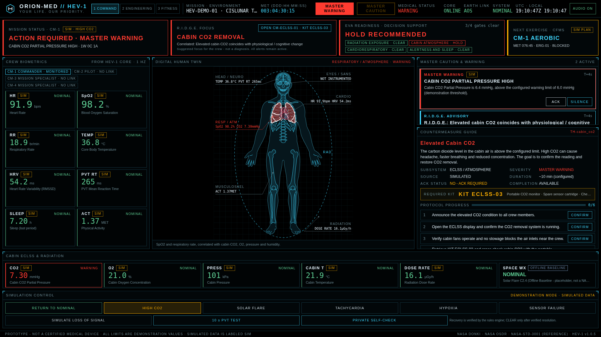

# ORION-MED // HEV-1
**Human Emergency and Vital Monitoring System** — *YOUR LIFE. OUR PRIORITY.*

An offline-first, deterministic medical monitoring and decision-support terminal prototype for astronauts on long-duration missions (lunar, cislunar, future Mars transit). It evaluates physiological, environmental and radiation telemetry, raises Master Caution / Master Warning alerts, guides the crew through structured countermeasure checklists and keeps working without a link to Earth.

NASA Space Apps Challenge 2026 — challenge: *Create Health Monitoring Software for Astronauts on Space Missions*.

> **Prototype — not a certified medical device.** All limits are demonstration values, all countermeasure texts are demonstration procedures, and every simulated value is labeled `SIM` in the interface. See [docs/SCIENTIFIC_LIMITATIONS.md](docs/SCIENTIFIC_LIMITATIONS.md).



**Two screens, one application** — switch with the tabs in the status bar or the keys `1` / `2`:
- **1 · COMMAND** — action-centric view: mission status, R.I.D.G.E. focus, EVA readiness (decision support), crew biometrics, the hand-made Digital Human Twin, active alerts with the countermeasure guide, cabin & radiation strip and simulation control.
- **2 · ENGINEERING** — full telemetry panels, zone details, radiation and NASA DONKI context, cabin ECLSS, persistent mission event log and simulator.

## Quick start

Requirements: **Python 3.12+** ([python.org](https://www.python.org/downloads/)) and **Node.js 20.19+ or 22.12+** ([nodejs.org](https://nodejs.org/)). No Docker, no database server, no API key needed.

**Windows**
```bat
setup.bat      :: once: Python venv + dependencies, builds the crew interface
run.bat        :: starts HEV-1 and opens http://localhost:8000
dev.bat        :: optional: hot-reload development (backend :8000 + Vite :5173)
rebuild.bat    :: optional: rebuild the production interface
stop.bat       :: optional: stop servers on ports 8000 / 5173
```

**Linux / macOS**
```bash
./setup.sh
./run.sh       # then open http://localhost:8000
```

The SQLite database (`backend/data/orion_med.db`) is created automatically on first launch. API documentation: http://localhost:8000/docs

<details><summary>Manual commands / development mode</summary>

```bash
cd backend
python -m venv .venv
.venv/bin/pip install -r requirements.txt        # Windows: .venv\Scripts\pip
.venv/bin/python -m uvicorn app.main:app --port 8000

cd ../frontend
npm install
npm run dev        # hot-reload UI on http://localhost:5173 (proxies /api to :8000)
npm run build      # production build served by the backend on :8000
```
</details>

Optional configuration: copy `.env.example` to `.env` (NASA API key, offline mode, ground sync endpoint, CFMS).

**Optional CFMS module (Crew Fitness Management System).** Set `ORION_CFMS_ENABLED=true` in `.env` to enable exercise scheduling against the SIMULATED Mission Plan, the Safety Gate and scoped Medical Clearance. Off by default. See [docs/CFMS.md](docs/CFMS.md).

## Demonstration (30-second script)

1. Open the interface (COMMAND screen): nominal simulated telemetry (all values tagged `SIM`), EVA readiness "NO BLOCKERS FOUND".
2. Click **HIGH CO2** in Simulation Control.
3. Within ~6 s: **MASTER WARNING**, voice announcement, respiratory zone highlighted on the Digital Human Twin, R.I.D.G.E. focus "CABIN CO2 REMOVAL", EVA readiness "HOLD RECOMMENDED".
4. Press **ACK**: audio is silenced, the warning stays active. The Countermeasure Guide shows **KIT ECLSS-03**; confirm steps.
5. Click **NOMINAL**: CO2 falls, the alert enters **RECOVERY**, resolution is verified with fresh data, **CLEAR** (press twice) archives it. Every transition stays in the Mission Event Log.

**CFMS scenario (optional, `ORION_CFMS_ENABLED=true`, fresh database).** Press `3` (FITNESS): CM-1 READY PER PLAN, CM-2…CM-4 CLEARANCE REQUIRED (no biosensor) → record a Medical Clearance for CM-2 · AEROBIC only → CONFIRM START for CM-1: the simulated load raises heart rate, the global MASTER CAUTION fires (limits unchanged, not suppressed) and the in-session monitor shows the DEMONSTRATION profile → COMPLETE → RECOVERY MONITOR: RECOVERING, then RECOVERED after 60 s → MISSION PLANNER: insert an unplanned maneuver and see the moved sessions with original window, conflict, reason and new window → EQUIPMENT STATUS: set RES-01 to FAULT and back. The demo plan starts at MET 076:30 on a fresh database (stop HEV-1 and delete `backend/data/orion_med.db*`).

Press `2` to see the persistent mission log on the ENGINEERING screen. Other scenarios: **HYPOXIA**, **SOLAR FLARE**, **TACHYCARDIA**, **SENSOR FAILURE**, plus *Simulate loss of signal* for the Earth-link queue. The browser enables audio after the first click (browser autoplay policy); visual alerts never depend on audio.

## What it does

| Area | Implementation |
|---|---|
| Telemetry | Normalized records (ID, parameter, value, unit, UTC timestamp, source, quality, mission, metadata), validation, plausibility checks, out-of-order protection |
| Rules engine | Configurable bands (`config/demo_thresholds.yaml`) with hysteresis and recovery hold time |
| Alert state machine | Per-instance lifecycle ACTIVE → RECOVERY → CLEARED, escalation / de-escalation, relapse, ACK, SILENCE, countermeasure progress, two-step CLEAR only after verified resolution |
| Missing data | `SENSOR_FAULT` and `DATA_STALE` alerts; a missing reading is never shown or evaluated as normal |
| EVA readiness & triage focus | Deterministic decision support from the same thresholds and active alerts: four gates (radiation, atmosphere, cardiorespiratory, alertness), missing data → DATA INCOMPLETE, never "safe/cleared"; suggested checklist to open first (not a diagnosis) |
| R.I.D.G.E. | Deterministic correlation of human state, cabin environment, space weather and operations; advisory only, explicitly “correlation ≠ causation” |
| Countermeasures | Structured YAML guides: description, subsystem, kit, steps, duration, progress, resolution criteria |
| Space weather | NASA DONKI FLR + SEP with 15-min SQLite cache and LIVE / CACHED_OFFLINE / OFFLINE_BASELINE tiers |
| Crew wellbeing | 10-second PVT (reaction time, lapses, misses, false starts, history) and private-by-default self-check |
| Offline | Local SQLite, persistent state after restart, PWA service worker, IndexedDB snapshot and outbox, ordered/idempotent Earth sync queue |
| Voice | Web Speech API + local WAV tones, mute / silence, graceful degradation |

## Architecture

```
React + TypeScript (Vite, Tailwind, Zustand, Recharts, SVG)  ← 1 Hz GET /api/state
        │
FastAPI (Python 3.12) ── Decision support engine (rules, alert FSM, R.I.D.G.E., stale monitor)
        │                └─ Mission simulator (same ingest path as real sensors)
SQLite (SQLAlchemy) ──── telemetry, alerts + history, countermeasures, PVT, self-checks, sync queue, NASA cache
        │
NASA DONKI / OSDR ────── cached, never blocking the onboard engine
```
Details: [docs/ARCHITECTURE.md](docs/ARCHITECTURE.md) · API: [docs/API.md](docs/API.md)

## NASA data and references

- **NASA DONKI** (Space Weather Database Of Notifications, Knowledge, Information) via https://api.nasa.gov/ — `GET /DONKI/FLR` and `GET /DONKI/SEP`, last 7 days; `GET /DONKI/notifications?type=FLR` as fallback when the FLR endpoint is unavailable. Context only, never a dose measurement.
- **NASA Open Science Data Repository** https://osdr.nasa.gov/ — research references OSD-569, OSD-360, OSD-479, OSD-922 (metadata inspected).
- **NASA-STD-3001** Vol. 1 https://www.nasa.gov/reference/nasa-std-3001v1/ and Vol. 2 https://www.nasa.gov/reference/nasa-std-3001v2/ — reference for crew health and environmental requirements; no numeric value is copied into the demonstration thresholds.

Full list and usage: [docs/DATA_SOURCES.md](docs/DATA_SOURCES.md)

## Tests

```bash
cd backend && .venv/bin/python -m pytest -q          # 131 tests: rules, alert FSM, scenarios, persistence, DONKI tiers, sync, API, CFMS
cd frontend && npm test                              # 24 tests: all screens, twin, ACK/SILENCE, guide, offline, simulator, PVT, voice cues, FITNESS
cd frontend && npx playwright install chromium && npm run e2e   # full demo script against a running instance (+ screenshots)
```

## Project structure

```
backend/app/        api/ cfms/ core/ engine/ integrations/ services/ schemas/ models.py main.py database.py
backend/tests/      pytest suite
frontend/src/       components/ modules/{biometrics,radiation,mental-health,alerts,digital-twin,simulator} services/ store/ hooks/ types/
config/             demo_thresholds.yaml  countermeasures.yaml  mission_defaults.yaml  references.yaml  mission_plan.yaml  fitness.yaml
docs/               ARCHITECTURE.md  API.md  CFMS.md  DATA_SOURCES.md  SCIENTIFIC_LIMITATIONS.md  screenshots/
tools/              generate_tones.py
```

## AI attribution

AI tools were used in this project. See [AI_ATTRIBUTION.md](AI_ATTRIBUTION.md) for what was generated, by which tool, and how.

## License

Apache License 2.0 — see [LICENSE](LICENSE). The “Half-Life HEV” reference is an aesthetic inspiration only; no Half-Life assets, dialogue or NASA logos are used.
